# deepseek-harness-memory-core

> A **zero-dependency memory core for AI agents** — pointer/core preloading, resident indexing with a hard budget, BM25/hybrid retrieval, daily-first writes, session-boundary extraction, superseding edits, auditable consolidation, and cloud-tier classification. Ships as a plugin for VanWork (DeepSeek Harness), but the memory engine itself is host-agnostic.

<p align="center">
  
  
  
  
  
</p>

> **Category:** 记忆 / Long-term memory · **Install:** `dsh plugin --profile web add vanwork-memory-core`

## What problem this solves

Long-running agents forget. Naive memory systems either inject everything every turn (killing prompt-cache hits and blowing context) or rely on the model to "remember on its own" (unreliable and unauditable). This library fills four gaps:

| Gap | Status quo | What this does |
|---|---|---|
| **Index is not a first-class citizen** | Key memories injected on demand, no global index with a budget | Injects a **dual-budget** resident index each turn; body expands on pointer |
| **No entry-level retrieval** | Filename / content-level file search only | `mem_search`: CJK bigram + FTS5 **BM25**, optional vector + **RRF** fusion |
| **Consolidation left to discipline** | Model-driven "consolidate" skill | `mem_consolidate`: **recomputable plan + fingerprint check + backup rollback** — computation and mutation separated |
| **No cloud boundary** | Git sync, but no "which entry may leave the machine" judgment | `classifyEntry` / `redactForCloud`: two axes + three gates (v0.1 judges only, no network) |

The core idea: it **does not own** the memory content. Memory remains plain Markdown on disk. This library owns only **derived indexes** (deletable & rebuildable at any time) plus **audit artifacts** (ledger, revisions, backups).



## Why it's different

- **Zero runtime dependencies.** Pure ESM, only `node:` built-ins. No build step, no transpilation — the bytes you publish are the bytes you audit.
- **Correctness over cleverness.** Superseding edits instead of destructive deletes (L1 archive / L2 supersede / L3 destroy). Cross-process file locks with staleness recovery. Atomic writes (temp → fsync → rename). Every mutation backs up first.
- **Recomputable, not "smart".** Consolidation produces a plan with a content-derived fingerprint; if memory changes after the plan, `apply` refuses. You always execute the plan you actually reviewed.
- **Prompt-cache aware.** Index entries are **slot-stable** (append-only, content-addressed) so the injected block keeps a stable prefix across turns — a measured jump from 11% to 78% reusable characters.
- **Cloud tiering by default offline.** No network, no keys, no hidden per-query cost unless you explicitly opt in.

## Quick start

### Install (DeepSeek Harness / VanWork)

```bash
# From npm (recommended)
dsh plugin --profile web add vanwork-memory-core
```

Or from a local tarball / git checkout:

```powershell
dsh plugin --profile web add <path-to-vanwork-memory-core-0.8.1.tgz>
```

After install, restart and run `mem_audit` — you should see the 10 `mem_*` tools registered.

### Run the tests

```bash
# Node >= 22.5.0
npm test                          # 476 tests
node --test "tests/*.test.js"
```

## The ten tools

| Tool | Purpose |
|---|---|
| `mem_search` | Retrieve over memory entries; returns pointers (`path#id`) + snippets + source |
| `mem_read` | Read full body by pointer/id, with staleness + cloud-tier verdict |
| `mem_write` | Append / replace / remove / **supersede**, with escalating confirm gates |
| `mem_extract` | Session-boundary extraction → writes `QUEUE.md` candidates |
| `mem_health` | Budget / staleness / consolidation / dupe / supersede / cloud / ledger |
| `mem_query_log` | Query log — what got retrieved, when, and how it scored |
| `mem_global` | Global (cross-project) memory management |
| `mem_audit` | Recomputable "who manages the store" report (read-only) |
| `mem_consolidate` | Plan (zero side effect) and apply (fingerprint-checked) |
| `mem_reindex` | Rebuild the derived index (always safe) |

## Key concepts

- **Three-level memory correction** — archive (out of attention, recoverable) → supersede (mark `[superseded-by:<id>]`, recoverable) → destroy (not yet implemented). Never silent-delete by default.
- **Suspicious-memory marking** — silently flag low-evidence entries (`fragment` / `inferred` / `contested` / `lowconfidence`), speak only when they resurface. Protected content (allergies / credentials / legal) is never flagged.
- **Tiered compaction** — hot (30d daily) / warm (monthly digest) / cold (monthly archive pack). Idempotent, never deletes originals.
- **Zero-token consolidation by default** — near-dupe merge, cold archiving, and log distillation are all deterministic local computations; the model only enters if you explicitly ask it to rewrite summaries.

## Configuration

See the full annotated defaults in `lib/config.js` (every default documents what was adopted and what was rejected). Highlights:

```yaml
- id: vanwork-memory-core
  config:
    indexMaxLines: 120        # resident index budget (lines)
    indexMaxChars: 8000       # resident index budget (chars)
    searchMode: auto          # auto | bm25 | hybrid
    embedding:
      enabled: false          # offline by default
    supersedeEnabled: true    # propose (not auto-apply) supersedes
    monthlyPackEnabled: true  # tiered compaction
    backend: auto             # auto | sqlite | json
```

## Verification

All reproducible, no network:

```powershell
$node = "$env:LOCALAPPDATA\Programs\VanWork\resources\runtime\node.exe"

node --test "tests/*.test.js"        # 476 unit tests
node scripts/verify.mjs              # end-to-end (13 steps)
node scripts/mount-probe.mjs         # real cordis tree + real services
node scripts/profile-probe.mjs       # real profile composition (dsh --dump-config)
node scripts/archive-contract.mjs    # cross-plugin archive format contract
```

## Directory layout

```
├── lib/            # pure ESM source (the audited bytes)
│   ├── index.js    # plugin entry
│   ├── scanner.js  # multi-root scan + § entry parsing + CJK tokenization
│   ├── indexdb.js  # SQLite FTS5 / pure-JS dual backend
│   ├── retrieve.js # hybrid retrieval + RRF + explainable scoring
│   ├── memfile.js  # safe read/write: lock + backup + atomic write
│   ├── consolidate.js
│   ├── cloud.js    # tiering + redaction
│   ├── inject.js   # resident index injection (budget + self-repair)
│   ├── audit.js    # "who manages the store" report
│   └── tools.js    # ten mem_* tools
├── scripts/        # reproducible verification probes
├── tests/          # 476 tests
└── docs/           # full technical documentation (Chinese)
```

## Documentation

Full technical documentation (in Chinese, written against the actual code):

- **How memory is stored / managed / retrieved** — [`docs/记忆插件技术文档.md`](docs/记忆插件技术文档.md)
- **Installation notes** — [`docs/安装说明.md`](docs/安装说明.md)

## Roadmap / honest limits

- `node:sqlite` is still experimental (one `ExperimentalWarning` on startup; set `backend: json` to avoid it).
- Vector retrieval is off by default — no embedding service on-device, and default-on would add hidden cost + privacy egress per query.
- Locks are single-machine; cross-device concurrency is resolved by the Git layer.
- The full Chinese README (with the detailed VanWork/DSH boundary discussion, decision records, and version history) lives in the git history and the technical doc.

## License

[MIT](LICENSE)
